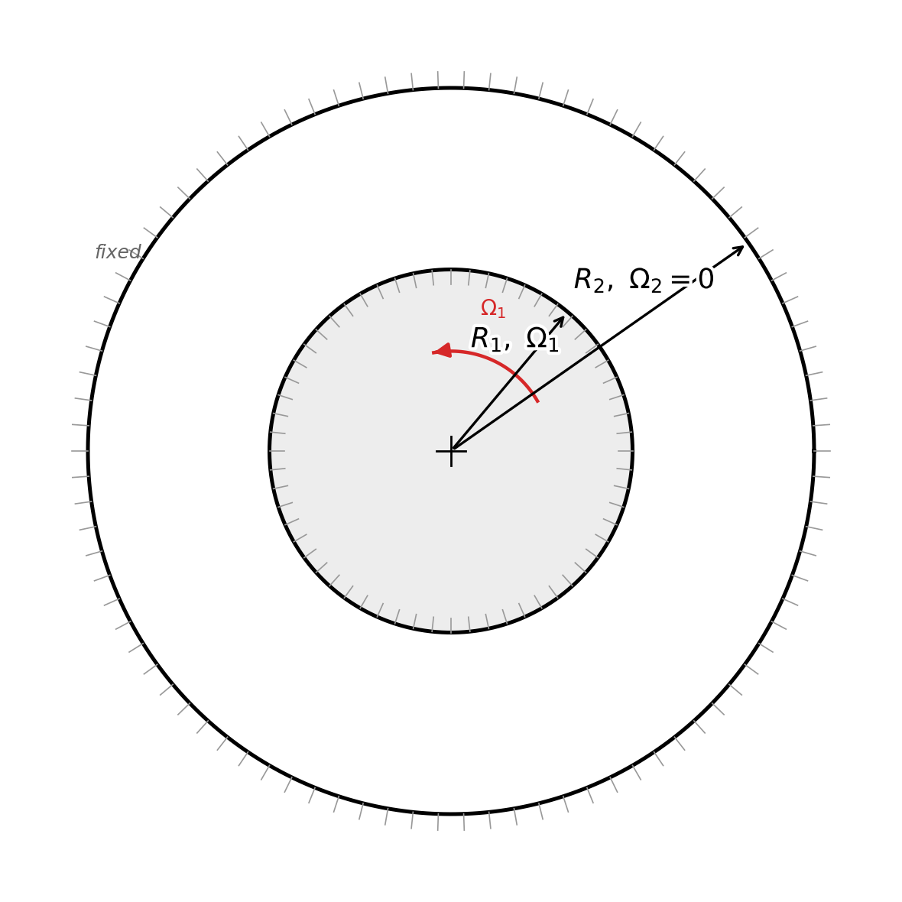
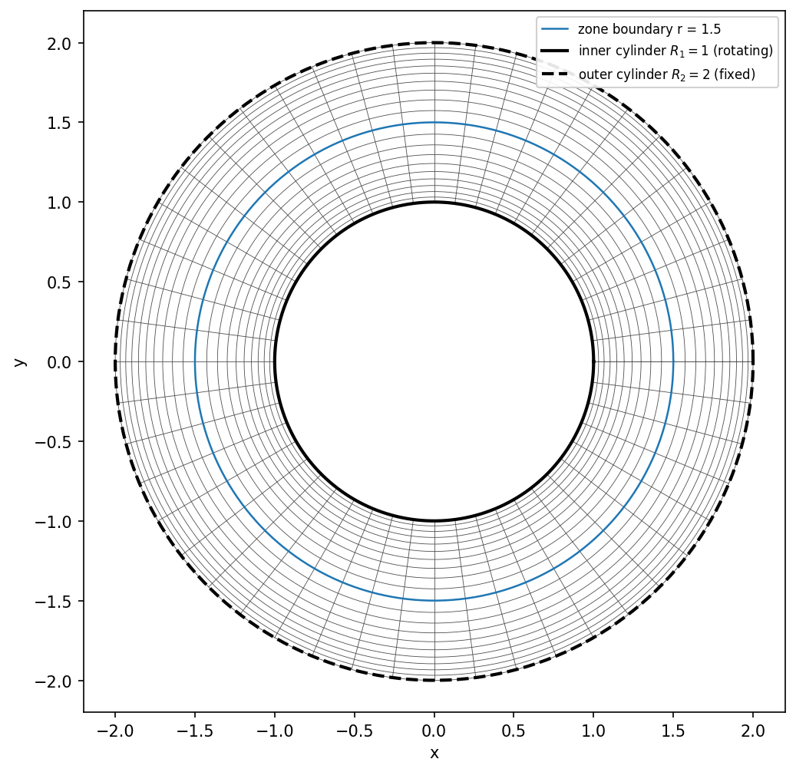
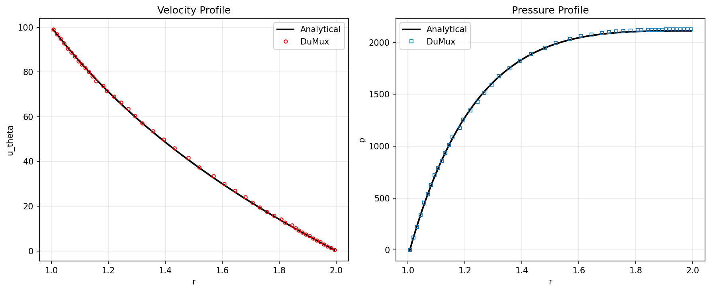

# Rotating Cylinders Benchmark

This benchmark addresses the classical **Taylor–Couette flow** problem: the viscous flow of an incompressible fluid confined between two concentric, independently rotating cylinders. The problem is solved numerically using the Navier–Stokes free-flow model implemented in [DuMux](https://dumux.org), and the resulting velocity and pressure fields are compared against the exact analytical solution. Because a closed-form solution exists, this configuration provides a rigorous and well-defined test case for verifying the accuracy and convergence behavior of the numerical scheme.

## Problem description

We consider two concentric cylinders: an inner cylinder of radius $R_1$ rotating at angular velocity $\Omega_1$, and an outer cylinder of radius $R_2$ rotating at angular velocity $\Omega_2$. The fluid occupying the annular gap between the cylinders is incompressible, and the resulting flow is steady and laminar.


*Geometry and rotation of the inner and outer cylinders defining the Taylor–Couette configuration, with the fluid-filled annular gap of width $d = R_2 - R_1$ between them.*

The laminar case considered here corresponds to a Reynolds number of $Re = 100$, defined as

$$
Re = \frac{|u_0| \, d}{\nu}
$$

where $u_0 = \Omega_1 R_1$ is the surface velocity of the inner cylinder, $d = R_2 - R_1$ is the gap width between the cylinders, and $\nu$ is the kinematic viscosity of the fluid. Using inner and outer radii of $R_1 = 1$ and $R_2 = 2$, respectively, and a kinematic viscosity of $\nu = 1$, a Reynolds number of $Re = 100$ corresponds to an inner cylinder angular velocity of $\Omega_1 = 100$ rad/s.


## Boundary conditions

$$
\begin{aligned}
u_{\theta} &= \Omega_1 R_1 & \text{on } r = R_1 & \quad \text{(inner cylinder, rotating)} \\
u_{\theta} &= \Omega_2 R_2 & \text{on } r = R_2 & \quad \text{(outer cylinder, fixed or rotating)}
\end{aligned}
$$

In the reference configuration, the outer cylinder is fixed ($\Omega_2 = 0$) and the inner cylinder rotates at $\Omega_1 = 100$ rad/s.


## Analytical solution

Taylor [@taylor1923] showed that the tangential velocity $u_{\theta}$ within the annular gap is described by:

$$
u_{\theta}(r) = A r + \frac{B}{r}
$$

with

$$
A = \frac{\Omega_2 R_2^2 - \Omega_1 R_1^2}{R_2^2 - R_1^2},
\qquad
B = \frac{(\Omega_1 - \Omega_2) R_1^2 R_2^2}{R_2^2 - R_1^2}
$$

Introducing the angular velocity ratio $\mu = \Omega_2 / \Omega_1$, the constants $A$ and $B$ can equivalently be expressed as:

$$
A = \frac{\Omega_1 \left(1 - \mu \dfrac{R_2^2}{R_1^2}\right)}{1 - \dfrac{R_2^2}{R_1^2}},
\qquad
B = \frac{R_1^2 \,\Omega_1 (1 - \mu)}{1 - \dfrac{R_1^2}{R_2^2}}
$$

Since the flow is steady and purely azimuthal, the governing equations in cylindrical coordinates reduce to a radial pressure balance:

$$
\frac{1}{\rho}\frac{\partial p}{\partial r} = \frac{u_{\theta}^2}{r}
$$

Integrating this expression with respect to $r$ yields the analytical pressure field:

$$
p(r) = \frac{A^2 r^2}{2} + 2AB \ln(r) - \frac{B^2}{2r^2} + C
$$

where $C$ is an integration constant determined by a reference pressure condition.


## Mesh

The computational domain is the annular region between the two cylinders, discretized using DuMux's [`CakeGridManager`](https://dumux.org/docs/doxygen/master/class_dumux_1_1_cake_grid_manager.html), which constructs a structured quadrilateral grid directly in polar coordinates.

According to `params.input`, the radial direction spans $R_1 = 1$ to $R_2 = 2$ over two zones (`Radial0 = 1.0 1.5 2.0`), each comprising 80 cells (`Cells0 = 80 80`) with mirrored grading (`Grading0 = 1.1 -1.1`) that refines the mesh near both cylinder walls while coarsening it toward mid-gap. The angular direction covers the full $360°$ (`Angular1`) with 320 uniform cells (`Cells1 = 320`).


*Structured quadrilateral mesh generated by the `CakeGridManager`, shown at reduced resolution (10 radial cells/zone × 48 angular cells) for legibility. Grading concentrates cells near both cylinder walls; the mesh used in the actual simulation comprises 80 radial cells/zone × 320 angular cells.*


## Comparison of numerical solution with analytical solution

The numerical solution $u_{\theta,h}$ and the analytical solution $u_{\theta}$ are compared using the $L_2$ error norm:

$$
e_{L_2} = \left\| u_{\theta} - u_{\theta,h} \right\|_{L_2} = \sqrt{\int_\Omega \left(u_{\theta}(\boldsymbol{x}) - u_{\theta,h}(\boldsymbol{x})\right)^2 \mathrm{d}\boldsymbol{x}}
$$

and the relative $L_2$ error:

$$
e_{L_2,\mathrm{rel}} = \frac{\left\| u_{\theta} - u_{\theta,h} \right\|_{L_2}}{\left\| u_{\theta} \right\|_{L_2}}
$$

Analogously, the numerical pressure field $p_h$ is compared to the analytical pressure $p$. Plotting the relative error against mesh size $h$ on a log–log scale allows the convergence order of the numerical scheme to be determined.

The radial velocity and pressure profiles obtained with DuMux (mesh configuration `100_0_80_320`) closely follow the analytical solution across the entire gap $r \in [1, 2]$ m:


*Radial profiles of tangential velocity $u_\theta(r)$ and pressure $p(r)$ from the DuMux simulation (mesh configuration `100_0_80_320`) plotted against the analytical Taylor–Couette solution across the gap $r \in [1, 2]$ m.*

This plot comes from `plot_results.py`:
```sh
pvpython plot_results.py --conf 100_0_80_320 --analytical
```

## License

This project is licensed under the GNU General Public License (GPL) version 3, or — at your option — any later version. The full license text is available at [GPL-3.0-or-later.txt](LICENSES/GPL-3.0-or-later.txt) in the `LICENSES` directory at the root of the source tree.

## Version information

|      module name      |      branch name       |                 commit sha                 |         commit date         |
|-----------------------|------------------------|--------------------------------------------|-----------------------------|
|       dune-istl       |  origin/releases/2.10  |  21c67275b17e93918365177f93f42e4aaa9afd23  |  2025-02-03 09:13:05 +0000  |
|       dune-grid       |  origin/releases/2.10  |  954436b88247e904628ec4d7c8bb7b2eaac08900  |  2024-10-22 15:31:40 +0000  |
|  dune-localfunctions  |  origin/releases/2.10  |  ddbf693b5f9c867b2d58d418fe130bbe92c06a99  |  2025-06-27 05:40:52 +0000  |
|     dune-geometry     |  origin/releases/2.10  |  5673e95ac364ad3498aed9eaf65e0d224384d15a  |  2024-09-04 16:39:39 +0200  |
|      dune-uggrid      |  origin/releases/2.10  |  cf2513efb6497dc95744649e0658cedef2980bff  |  2024-09-05 08:40:59 +0200  |
|      dune-common      |  origin/releases/2.10  |  fa09b5bd31efa38cc051e22717b0d259de5ae8a1  |  2025-06-03 21:04:17 +0000  |

## Installation

### Option 1: Manual installation

Create a root folder (e.g. `DUMUX`), navigate into it, clone this repository, and run the provided install script, `install_rotating-cylinders.sh`, to install all dependent modules:

```sh
mkdir DUMUX
cd DUMUX
git clone https://git.iws.uni-stuttgart.de/benchmarks/rotating-cylinders.git rotating-cylinders
./rotating-cylinders/docker/install_rotating-cylinders.sh
```

This clones every required module into `DUMUX`, configures everything with `dunecontrol`, and builds the tests.

### Option 2: Docker

A `Dockerfile` is included that builds all dependencies and the benchmark executable into a single image.

Build the image:
```sh
docker build -t git.iws.uni-stuttgart.de:4567/benchmarks/rotating-cylinders .
```

Start a container and drop into a shell, with the current directory mounted as the shared workspace at `/dumux/shared`:
```sh
./docker_rotatingCylinders.sh open
```

## Running the simulation

The executable `test_ff_navierstokes_rotatingcylinders` reads its configuration from `params.input`, which controls:
* `[Grid]` — mesh resolution and grading, and the radial/angular extent of the annulus
* `[Problem]` — inner/outer cylinder angular velocities (`Omega1`, `Omega2`) and whether inertia terms and gravity are enabled
* `[Component]` — fluid density and dynamic viscosity
* `[LinearSolver]` / `[Newton]` — solver and convergence settings

```sh
./test_ff_navierstokes_rotatingcylinders params.input
```

On completion, the run produces:
* `solution_metrics.json` — relative $L_2$ errors of pressure and velocity against the analytical Taylor–Couette solution
* `<Problem.Name>.zip` — the `.pvd`/`.vtu` VTK output files

## References

Taylor, G. I. (1923). VIII. Stability of a viscous liquid contained between two rotating cylinders. *Philosophical Transactions of the Royal Society of London. Series A, Containing Papers of a Mathematical or Physical Character*, 223(605–615), 289–343. https://doi.org/10.1098/rsta.1923.0008